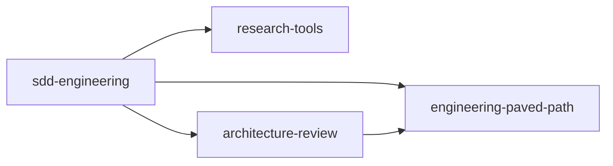
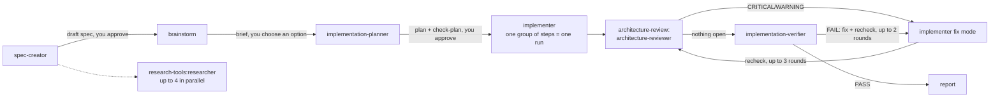

# Specification: Spec Driven Development plugins for `test-ai-marketplace`

| | |
|---|---|
| Status | Draft v1 — pending approval; implementation not started |
| Date | 2026-10-20 |
| Repo | https://github.com/artemmmon/test-ai-marketplace (branch `main`) |
| Source | https://github.com/artemmmon/dev-digest, `main` @ `e6f0a5d` (`.claude/agents`, `.claude/skills`, `.claude/hooks`, `evals/`) |
| Context | GoIT lab: steps 2–5 ("select components", "dependency graph", "package sdd-engineering", "register plugins") |

Notation: **FR-n** — requirement, **NFR-n** — non-functional requirement, **R-n** — placement rule, **S-n** — spike (a check before implementation), **Q-n** — open question. "MUST" — mandatory, "SHOULD" — recommended.

This specification describes **what** will be in the repository and **how** it is structured. It does not move any files. Implementation proceeds in separate PRs per §11 after approval.

## Table of contents

1. [Goal and non-goals](#1-goal-and-non-goals)
2. [Repository state: current and target](#2-repository-state-current-and-target)
3. [Catalog and dependency graph](#3-catalog-and-dependency-graph)
4. [Claude Code platform constraints](#4-claude-code-platform-constraints)
5. [The `sdd-engineering` plugin](#5-the-sdd-engineering-plugin)
6. [The `research-tools` and `architecture-review` plugins](#6-the-research-tools-and-architecture-review-plugins)
7. [The `engineering-paved-path` plugin and skill placement rules](#7-the-engineering-paved-path-plugin-and-skill-placement-rules)
8. [Stripping DevDigest: explicit inputs](#8-stripping-devdigest-explicit-inputs)
9. [Versions and releases](#9-versions-and-releases)
10. [Documentation, evals, checks and acceptance](#10-documentation-evals-checks-and-acceptance)
11. [Phasing](#11-phasing)
12. [Spikes and open questions](#12-spikes-and-open-questions)
13. [Appendix: source → target file map](#13-appendix-source--target-file-map)

---

## 1. Goal and non-goals

### 1.1 Goal

Extract from DevDigest a set of plugins that gives any repository a **Spec Driven Development (SDD)** process: spec → implementation options → plan → implementation → verification, plus a retro of the run. Some of the plugins are **reusable dependencies** that can be installed on their own; the rest is bundled into `sdd-engineering`, which depends on them.

Four plugins:

| Plugin | Role | What it provides |
|---|---|---|
| `engineering-paved-path` | dependency | React, Next.js, Fastify, architecture, testing and security skills |
| `research-tools` | dependency | the read-only `researcher` agent |
| `architecture-review` | dependency | the generalized read-only `architecture-reviewer` agent |
| `sdd-engineering` | main | 5 SDD agents, the skills `run-plan`, `workflow-retro`, `spec-authoring`, a README on how everything works together, and `CHANGELOG.md` |

### 1.2 Non-goals

- Moving anything from DevDigest that is not named in §5–§7 (in particular the `doc-writer`, `test-writer`, `security-reviewer`, `pr-*` agents, `pr-self-review`, `dependency-checker`, `devdigest-demo`). See Q-3.
- DevDigest product specs (`specs/*.md`), secrets, cache, DevDigest-specific instructions (`references/devdigest.md`, `AGENTS.md`, DevDigest's `INSIGHTS.md`) — are not moved (the "Not moving" slide).
- Changes to the catalog site. The site already expects the structure `plugins/<name>/{plugin.json, README.md, CHANGELOG.md, COMPATIBILITY.md}` and the tags `<plugin>--v<semver>` (`docs/specs/site.md` FR-22, FR-26); this specification only fills the catalog.
- Implementation, PRs and merge: on the user's request.

### 1.3 Selection principle

A plugin receives only what (a) works without DevDigest and (b) its role needs. If an agent or skill in the source relies on a DevDigest path, command or convention, that is not a reason to leave it out: it is moved **with an explicit input instead of the hard-coded value** (§8).

---

## 2. Repository state: current and target

| Item | Current | Target |
|---|---|---|
| `.claude-plugin/marketplace.json` | `plugins: []` | 4 entries, sorted by `name` |
| `plugins/` | only `.gitkeep` | 4 directories with the structure from §3.2 |
| `scripts/check-marketplace.mjs` | sort / dup / name regex / hidden Unicode / pinning / name+version / frontmatter `name` | + FR-13 checks |
| `README.md` (root) | "catalogue is empty for now" | a table of the 4 plugins, installation order |
| Git tags | none | `<plugin>--v1.0.0` for each plugin (§9) |
| `docs/specs/` | `site.md` | + this file |

The catalog site stays unchanged; it reads `plugins/` and `marketplace.json`.

---

## 3. Catalog and dependency graph

### 3.1 Graph



- **FR-1.** `sdd-engineering` declares three dependencies in `plugin.json`, each with the range `^1.0.0`:
  ```json
  "dependencies": [
    { "name": "engineering-paved-path", "version": "^1.0.0" },
    { "name": "research-tools",         "version": "^1.0.0" },
    { "name": "architecture-review",    "version": "^1.0.0" }
  ]
  ```
  A bare string `"name"` without a range is not used: without a range the dependency moves with every marketplace release ([docs](https://code.claude.com/docs/en/plugin-dependencies)).
- **FR-2.** `architecture-review` depends on `engineering-paved-path ^1.0.0`. This is a **deviation from the step 3 slide**, where the graph is flat. Reason: the generalized reviewer reads its rubric from the skills `onion-architecture` and `frontend-architecture`, which live in `engineering-paved-path`. Without the dependency, a standalone `architecture-review` would silently lose the rubric ("if a skill is missing, Claude Code skips it and writes to the debug log"). See Q-2.
- **FR-3.** Cycles are forbidden. `engineering-paved-path` and `research-tools` have no dependencies.
- **FR-4.** Dependencies are installed automatically, including transitive ones. `sdd-engineering` still lists `engineering-paved-path` explicitly: its skills are used directly by the `sdd-engineering` agents, not only through `architecture-review`.

### 3.2 Structure

```
plugins/
  engineering-paved-path/
    .claude-plugin/plugin.json
    skills/{react-best-practices,next-best-practices,fastify-best-practices,
            onion-architecture,frontend-architecture,react-testing-library,security}/…
    README.md  CHANGELOG.md  COMPATIBILITY.md
  research-tools/
    .claude-plugin/plugin.json
    agents/researcher.md
    README.md  CHANGELOG.md  COMPATIBILITY.md
  architecture-review/
    .claude-plugin/plugin.json
    agents/architecture-reviewer.md
    README.md  CHANGELOG.md  COMPATIBILITY.md
  sdd-engineering/
    .claude-plugin/plugin.json
    agents/{spec-creator,brainstorm,implementation-planner,implementer,implementation-verifier}.md
    skills/{run-plan,workflow-retro,spec-authoring}/…
    hooks/hooks.json  scripts/…
    evals/…
    README.md  CHANGELOG.md  COMPATIBILITY.md
```

- **FR-5.** `.claude-plugin/` contains only `plugin.json`. Everything else (`skills/`, `agents/`, `hooks/`, `README.md`, `CHANGELOG.md`) lives at the plugin root.
- **FR-6.** Each plugin is self-contained within its own directory: no symlinks, no `../`. A plugin is copied into the cache on its own, and external files are lost.
- **FR-7.** Names are kebab-case and do not start with `claude-`, `anthropic-`, `cc-plugin-`. All four pass.

---

## 4. Claude Code platform constraints

These are facts verified against the documentation that shape the design. What the documentation does not confirm is moved into spikes (§12).

| # | Fact | Consequence for the design |
|---|---|---|
| P-1 | Plugin agents **ignore** the frontmatter fields `hooks`, `mcpServers`, `permissionMode` ([sub-agents](https://code.claude.com/docs/en/sub-agents)) | The DevDigest `spec-creator-guard`, `plans-guard` and `check-*` hooks cannot stay in frontmatter. We move them into the plugin's `hooks/hooks.json` (FR-18). Spike S-3 |
| P-2 | Plugin agents have scoped names `plugin:agent`, e.g. `research-tools:researcher` | All references of agents and skills to one another in text are scoped (FR-17) |
| P-3 | `Agent(type)` in `tools` works only for the main thread (`claude --agent`); in a subagent the list of types is **ignored** | The restriction "spec-creator may launch only researcher" can no longer be expressed in frontmatter; it remains only in the hook (FR-18) and in the agent's text |
| P-4 | `skills:` in agent frontmatter preloads the full text of skills; the documentation does **not** say whether the scoped name `plugin:skill` works or whether dependency skills are visible | Spike S-2; fallback in FR-16 |
| P-5 | A skill with `disable-model-invocation: true` cannot be preloaded into an agent | `run-plan` and `workflow-retro` (launched by the user) have this flag; `spec-authoring` does **not** (it is preloaded by `spec-creator`) |
| P-6 | `${CLAUDE_SKILL_DIR}` → the directory of `SKILL.md` (for plugin skills, the skill's subdirectory, not the plugin root); `${CLAUDE_PLUGIN_ROOT}` is available in skills, agents, hooks; both are substituted in the Markdown body, but **not** in the env of Bash commands | Skill scripts are located via `${CLAUDE_SKILL_DIR}`, not `.claude/skills/` (step 4 slide). Hooks — via `${CLAUDE_PLUGIN_ROOT}` |
| P-7 | A dependency `{name, version: "^1.0.0"}` is resolved by the git tag `<plugin>--v<ver>`; for a plugin with a relative path, if there is no tag, the current marketplace copy is used, and the range is checked at load time | The `--v1.0.0` tags MUST exist before anyone installs a plugin with a dependency (§9) |
| P-8 | `userConfig` in `plugin.json` prompts for values when the plugin is enabled; non-sensitive values are substituted as `${user_config.KEY}` in skill and agent content | The explicit inputs mechanism (§8.2) |
| P-9 | `claude plugin eval` reads `evals/<case>/{prompt.md, graders/*.md, case.yaml}`; it does **not** read the `evals.json` format from skill-creator; the run happens in an isolated workspace without other plugins and `CLAUDE.md` | The DevDigest evals must be converted (§10.3); dependencies in isolation — spike S-5 |
| P-10 | `claude plugin tag --push` creates `<plugin>--v<version>`, checks `plugin.json` ↔ the marketplace entry, and a clean tree | The release step (§9.3) |

---

## 5. The `sdd-engineering` plugin

### 5.1 Composition

**Agents (5).** This is the list from your description; the step 2 slide names four ("plan-verifier", no brainstorm). See Q-1.

| Agent | Source in DevDigest | Model | What it does | Writes files |
|---|---|---|---|---|
| `spec-creator` | `agents/spec-creator.md` | opus | Two passes: a discovery report (questions, gaps, edge cases) → after the answers, a spec with `Status: draft` | only `<specs_dir>/*.md`, only `draft` |
| `brainstorm` | `agents/brainstorm.md` | sonnet | 3–5 implementation options in a weighted matrix with a sensitivity check, or a short brief if there is only one option; recommends one | only its own brief `<plans_dir>/NN-*.brainstorm.md` |
| `implementation-planner` | `agents/implementation-planner.md` | opus | Requirements review (questions, recommendations, mode) → a Development Plan in which every step cites spec ids (`AC-n`, `EC-n`, `NFR-n`) | only its own plan `<plans_dir>/NN-*.md`, only `draft` |
| `implementer` | `agents/implementer.md` | sonnet | Executes one group of steps of an approved plan, fixes the tests it broke, runs checks, reconciles its diff against the plan; fix mode driven by a list of gaps | project code |
| `implementation-verifier` | `agents/implementation-verifier.md` | sonnet | The final gate: read-only tracing of the finished code to every spec requirement and plan step, verdict `PASS`/`FAIL`/`INCOMPLETE`; `recheck:` after a fix | no |

**Skills (3).**

| Skill | Invoked by | Source | Purpose |
|---|---|---|---|
| `run-plan` | the user (`/sdd-engineering:run-plan`) | `skills/sdd` + `skills/feature-flow` | The entry point. Accepts a spec, plan, designs and requirements text in any combination, determines the stage and drives it along the route in §5.3. See Q-4 |
| `workflow-retro` | the user | `skills/workflow-retro` | Measures a completed run from the transcripts on disk (tokens, cache read, tool calls, duration, parallelism, nested subagents), proposes 3–5 concrete actions and appends a row to the ledger |
| `spec-authoring` | the agents `spec-creator`, `implementation-planner`, `implementation-verifier` | `skills/spec-authoring` | Spec template, EARS criteria, ids `US/AC/EC/NFR/OQ`, provenance tags, lifecycle `draft → approved → implemented`; the script `check-spec.mjs` |

- **FR-8.** `run-plan` and `workflow-retro` have `disable-model-invocation: true` (only the user launches them; they have side effects: launching agents, writing the ledger). `spec-authoring` does not (P-5).
- **FR-9.** All five agents and all skills are in English, as in the source; the README and CHANGELOG are in English for the public catalog (Q-6).

### 5.2 Hooks and scripts

DevDigest keeps its guard and check hooks in agent frontmatter (P-1 forbids this for a plugin) and in `.claude/hooks/`.

| Source | Purpose | In the plugin |
|---|---|---|
| `hooks/spec-creator-guard.mjs` | `spec-creator` writes only `specs/*.md` with `Status: draft`, launches only `researcher`, and uses MCP only to read Figma | `scripts/spec-creator-guard.mjs`, wired in `hooks/hooks.json` |
| `hooks/plans-guard.mjs` | `brainstorm` and the planner write only their own file in `docs/plans/`, only `draft` | `scripts/plans-guard.mjs` |
| `skills/spec-authoring/assets/check-spec.mjs` | spec shape; PostToolUse | in the skill (`${CLAUDE_SKILL_DIR}/assets/`) + a call from the hook |
| `skills/feature-flow/assets/check-plan.mjs` | plan: every `AC/EC/NFR` has a step, the spec is `approved`; `--implemented` for the verifier | in `run-plan/assets/` |
| `skills/workflow-retro/assets/{retro.mjs,prices.json}` | transcript measurement | in the skill |

- **FR-10.** Scripts are self-contained Node ESM with no dependencies; their tests (`*.test.mjs`) are moved alongside.
- **FR-11.** Scripts locate their files relative to `${CLAUDE_SKILL_DIR}` / `${CLAUDE_PLUGIN_ROOT}`. No `.claude/skills/` or `$CLAUDE_PROJECT_DIR/.claude/...` in plugin content.
- **FR-12.** Scripts obtain project paths (the specs and plans directories, the retro ledger) via `CLAUDE_PLUGIN_OPTION_<KEY>` or arguments, not from constants (§8.2).
- **FR-18.** `hooks/hooks.json` MUST apply only to the corresponding plugin agents, not to all of the user's sessions. For this, each guard first checks that the caller is the required agent (the agent type field in the hook's input JSON) and otherwise exits successfully without doing anything. If S-3 shows that the field does not exist, the fallback is: the guard works only by path matching (`specs_dir`, `plans_dir`) without binding to an agent, or the guards are not shipped and the limits remain in `tools` and in the agents' text.

### 5.3 The `run-plan` route



Route rules carried over without change in substance (source: `agents/README.md`, `feature-flow/SKILL.md`):

- **FR-14.** Two approvals belong to the user: the spec and the plan start with `Status: draft`; the main session sets `approved` only on the user's words. `brainstorm` and the planner stop at a draft spec, `implementer` — at a draft plan.
- **FR-15.** The plan is the only handoff to `implementer`: steps carry files, rules with `path:line`, and a "Done when" condition. In prompts to agents — paths, not content.
- **FR-16.** Preload fallback (P-4): if S-2 shows that `skills:` does not see dependency skills, the agents do not have the `skills:` field for skills from `engineering-paved-path`, and as the first step in their body invoke them through the Skill tool by scoped name (`engineering-paved-path:onion-architecture`).
- **FR-17.** All references between components are scoped: `research-tools:researcher`, `architecture-review:architecture-reviewer`, `engineering-paved-path:react-best-practices`. Own components — `sdd-engineering:spec-creator` and so on.
- Branches that remain: the architecture fix loop (up to 3 rounds, then stop and ask the user), the verifier (up to 2 rounds), amendment of an approved spec through `spec-creator` (new id, an `Amended:` line, re-approval; ids are not renumbered).
- Tests are off by default (as in the source): `implementer` only fixes broken tests. `test-writer` is not moved (Q-3), so `--tests` in `run-plan` is not shipped in v1.0.0.
- The stages `security-reviewer`, `doc-writer`, `pr-skill-reviewer`, `pr-self-review` from the source route are **excluded**. `run-plan` ends with a report after the verifier and says that the remaining steps are outside the plugin.

### 5.4 `plugin.json`

```json
{
  "name": "sdd-engineering",
  "version": "1.0.0",
  "description": "Spec Driven Development: spec → options → plan → implementation → verification, with a run-plan entry point and a workflow retro",
  "author": { "name": "artemmmon" },
  "license": "<see Q-7>",
  "keywords": ["sdd", "spec-driven", "planning", "agents"],
  "dependencies": [ /* FR-1 */ ],
  "userConfig": { /* §8.2 */ }
}
```

---

## 6. The `research-tools` and `architecture-review` plugins

### 6.1 `research-tools` → the `researcher` agent

- Source: `agents/researcher.md`. Read-only: `tools: Read, Grep, Glob, Bash, WebSearch, WebFetch, AskUserQuestion, Skill`, `disallowedTools: Write, Edit, NotebookEdit`, `model: sonnet`.
- Answers **one** specific question from the repository, external sources, or both; returns a Repository report and/or External report (Answer · Findings with evidence · Code map / Sources · Conflicts · **Not found**) or a Clarification report.
- **FR-19.** Remove the DevDigest examples (`server/`, `INSIGHTS.md`, `AGENTS.md`) from the text. Read `AGENTS.md` / `CLAUDE.md` / `INSIGHTS.md` only "if they exist".
- **FR-20.** The plugin has no dependencies and no skills; the `skills/` directory is absent.
- `AskUserQuestion` is filtered out when the agent runs as a subagent; therefore the agent has the Clarification report as an output (source behavior, retained).

### 6.2 `architecture-review` → the `architecture-reviewer` agent

- Source: `agents/architecture-reviewer.md`. A read-only audit of a module, package or branch diff; mechanical checks first, then judgment; returns a single JSON object (`checks`, `findings` with `id` and `in_change`, `rechecked`, `rubric_read`, `not_checked`) or a clarification JSON; `recheck:` after a fix.
- `skills: onion-architecture, frontend-architecture` — from `engineering-paved-path` (FR-2, FR-16).
- **FR-21 (generalization).** The three hard-coded DevDigest commands (`pnpm arch`, `pnpm lint`, `./scripts/shared-contracts.sh check`) are replaced by the input `checks` — a list of commands the agent may run (empty by default; then `checks: []` and `not_checked` names the reason). The agent, as before, does not run `--fix` / `sync`.
- **FR-22.** The `client/` / `server/` directory is no longer hard-coded: `mode: module` accepts `target`, and the rules for server and client are chosen by the content of `target` (backend → `onion-architecture`, frontend → `frontend-architecture`).
- **FR-23.** The output JSON schema does not change (it is read by `run-plan`).
- `architecture-reviewer-lite` (an experiment in the source) is **not moved**.

---

## 7. The `engineering-paved-path` plugin and skill placement rules

### 7.1 Placement rules

- **R-1.** A skill lives in the plugin whose agents or route use it **and** where other plugins do not need it. Workflow skills (`run-plan`, `workflow-retro`, `spec-authoring`) — in `sdd-engineering`.
- **R-2.** A skill of knowledge about the stack, architecture, tests and security that agents of several plugins need, or a person needs without SDD, goes in `engineering-paved-path`.
- **R-3.** A skill lives in exactly one plugin. Duplicates between plugins are forbidden; the rest use it through a dependency.
- **R-4.** Dependencies go only in the direction "consumer → provider" (the §3.1 graph). The provider does not know about the consumer.
- **R-5.** A skill that has `references/devdigest.md` (a mapping of rules onto DevDigest) or a script with hard-coded DevDigest paths is moved without that file; its content is either generalized into `references/` or discarded (§8).

### 7.2 Distribution of skills from DevDigest

| Skill (DevDigest) | Decision | Where to | Note |
|---|---|---|---|
| `react-best-practices` | **include** | `engineering-paved-path` | origin is not in `skills-lock.json` — establish the author and license (NFR-2) |
| `next-best-practices` | **include** | `engineering-paved-path` | vendored from `vercel-labs/next-skills` |
| `fastify-best-practices` | **include** | `engineering-paved-path` | vendored from `mcollina/skills` |
| `onion-architecture` | **include, generalize** | `engineering-paved-path` | remove `references/devdigest.md`; keep `assets/dependency-cruiser.cjs` as an example config with parameterized layers |
| `frontend-architecture` | **include, generalize** | `engineering-paved-path` | remove `references/devdigest.md` |
| `react-testing-library` | **include** | `engineering-paved-path` | the "testing" category from the slide; origin — to be checked (NFR-2) |
| `security` | **include, rewrite** | `engineering-paved-path` | in the source these are DevDigest trust boundaries (SSRF guard, clone paths, prompt fencing); in v1.0.0 — stack-independent rules (input, outbound HTTP, SQL, processes, secrets/logs, CI) and a scale for rating findings |
| `spec-authoring` | include | `sdd-engineering` | R-1 |
| `feature-flow` + `sdd` | merge into `run-plan` | `sdd-engineering` | Q-4 |
| `workflow-retro` | include | `sdd-engineering` | |
| `engineering-insights` | **open** | Q-5 | used by the planner and implementer; tied to DevDigest's `INSIGHTS.md` |
| `zod`, `typescript-expert`, `drizzle-orm-patterns`, `postgresql-table-design` | not in v1.0.0 | — | not named on the slide; all vendored — a license is needed. Candidates for 1.1.0 (Q-3) |
| `mermaid-diagram`, `dependency-checker`, `pr-self-review`, `devdigest-demo` | do not move | — | `devdigest-demo` is DevDigest-specific; the others are not in the list |

- **FR-24.** The `engineering-paved-path` catalog is skills only, with no agents, hooks or MCP. Scripts are allowed only as examples that a skill asks to be run explicitly (for example, the dependency-cruiser config).
- **FR-25.** Vendored skills keep the upstream structure, the `LICENSE`, and a reference to the source in the plugin's `README.md` and in the `references`/skill header (in the source this is `skills-lock.json`; in the plugin, the "Sources" section of the README).
- **FR-26.** Where they are invoked from: from agents — by scoped name (FR-17); the user sees them as `/engineering-paved-path:<skill>`.
- **FR-27.** Every skill's `description` includes triggers; `name` in frontmatter = the directory name (checked by `check-marketplace.mjs`).

---

## 8. Stripping DevDigest: explicit inputs

### 8.1 Rules

- **FR-28.** The following are forbidden in plugin content (agents, skills, scripts, README): the word `DevDigest` (except the mention "extracted from DevDigest" in the root README and the Sources section), the paths `server/`, `client/`, `reviewer-core/`, `.claude/skills/`, `.claude/hooks/`, `$CLAUDE_PROJECT_DIR/.claude/`, the commands `pnpm …`, `./scripts/check-changed.sh`, `./scripts/shared-contracts.sh`, references to `routing.json`, DevDigest's `AGENTS.md`, and `INSIGHTS.md` as a required file.
- **FR-29.** What is not moved: product specs, secrets, cache files, DevDigest-specific instructions (step 2 slide).

### 8.2 Inputs via `userConfig` and arguments

Instead of hard-coded values, `sdd-engineering` declares `userConfig` (non-sensitive values; substituted as `${user_config.KEY}` in agent and skill content and as `CLAUDE_PLUGIN_OPTION_<KEY>` in hooks):

| Key | Type | Default | Replaces in DevDigest |
|---|---|---|---|
| `specs_dir` | directory | `specs` | `specs/`, `<package>/specs/` |
| `plans_dir` | directory | `docs/plans` | `docs/plans/` |
| `retro_ledger` | file | `docs/retros/ledger.md` | `docs/retros/ledger.md` |
| `check_commands` | string, `multiple: true` | empty | `./scripts/check-changed.sh`, `pnpm typecheck/test/lint` |
| `architecture_checks` | string, `multiple: true` | empty | `pnpm arch`, `pnpm lint`, `shared-contracts.sh check` |

- **FR-30.** Empty `check_commands` means: `implementer` takes the commands from the **Verification** section of the approved plan, and `implementation-verifier` from the same section; without them both state explicitly in the report "checks not run: no commands configured".
- **FR-31.** `routing.json` (the "path → skills → checks" map from `pr-self-review`) is **not moved**. The planner selects skills by their `description` among those available and by the project's `CLAUDE.md` / `AGENTS.md` (if they exist) and records the choice in the plan steps (`Practices`, `load:`). This changes the source: there the map is deterministic. See Q-8.
- **FR-32.** The instruction "read the module's `INSIGHTS.md`" becomes conditional (Q-5).
- **FR-33.** Agents also accept inputs in the prompt (`specs_dir:`, `plans_dir:`, `checks:`); the prompt overrides `userConfig`.

---

## 9. Versions and releases

- **FR-34.** SemVer. All four plugins start at `1.0.0`. `version` is set in `plugin.json`; the `marketplace.json` entry does not duplicate it (the root README rule: "version in `plugin.json` only"). This is a deviation from the step 5 slide, where `version` is named alongside `name`, `owner`, `source`; see Q-9.
- **FR-35.** Every plugin has a `CHANGELOG.md` in Keep a Changelog format. The release heading is `## [1.0.0] - 2026-10-20` (recognized by the site's `scripts/build-index.mjs`, FR-26 in `site.md`); `## [Unreleased]` goes on top. The newest version in the changelog = `version` in `plugin.json`.
- **FR-36.** Every plugin has a `COMPATIBILITY.md`: the minimum Claude Code version (dependence on `userConfig`, `dependencies` with ranges, `claude plugin tag` — determine from the documentation and enter as a number), the list of dependencies and ranges. The site displays it under "Details".
- **FR-37.** A `version` bump is mandatory for any change to plugin content (otherwise users will not receive the files). A change that breaks scoped names, `userConfig` keys, the agents' output JSON, or the spec / plan format is MAJOR.
- **FR-38.** Range rule: `sdd-engineering` declares `^1.0.0`. MINOR/PATCH of dependencies are picked up; a MAJOR of a dependency requires a new `sdd-engineering` release with an extended range after an evals run.

### 9.3 Release order

1. Release the dependencies first: `engineering-paved-path`, `research-tools`; then `architecture-review` (depends on the first); `sdd-engineering` last.
2. For each: `claude plugin validate` → `node scripts/check-marketplace.mjs` → a commit with the bump and a CHANGELOG entry → the tag `claude plugin tag plugins/<name> --push` (`<plugin>--v1.0.0`).
3. The tags MUST be pushed **before** the `marketplace.json` with the entries lands in `main` (P-7), otherwise the dependency will resolve only "by current copy" and the range will not be checked against a tag.
4. Releasing `sdd-engineering` without updating the tag of changed dependencies is forbidden.

---

## 10. Documentation, evals, checks and acceptance

### 10.1 README of `sdd-engineering` (mandatory, "how everything works together")

Sections:

1. What it is and who it is for; the dependency diagram (§3.1).
2. Installation: `claude plugin marketplace add artemmmon/test-ai-marketplace`, `claude plugin install sdd-engineering@test-ai-marketplace` (dependencies install themselves); how to update (manual update from the root README).
3. Composition: a table of agents (role · model · what it writes · what it cannot do) and skills.
4. Route: the §5.3 diagram and an explanation of the two approvals, the bounded fix loops, and "the spec says what, the plan says how".
5. Quick start: an example `run-plan` run from requirements text and from a ready spec; how to invoke an individual agent by name (`--only spec`, `--only plan`, if Q-4 keeps the flags).
6. Inputs: the `userConfig` table (§8.2) and where to change them.
7. Who depends on whom and why (`engineering-paved-path`, `research-tools`, `architecture-review`) — with links to their READMEs.
8. What is intentionally not included (§1.2) and how to connect it separately.
9. Cost: briefly on the principle "paths, not content", one implementer run per group, no test stage — from the source `agents/README.md` "Keeping token cost down".
10. Retro: what `workflow-retro` measures, where it writes the ledger.
11. Security: what the plugin executes (hooks, scripts) — a list of files worth reading before installation.
12. Links to `CHANGELOG.md` and `COMPATIBILITY.md`.

The READMEs of the other three plugins are shorter: purpose, composition, the agent's input contract, dependencies, version.

### 10.2 Root README

A table of plugins (name · role · dependencies · version), "start with `sdd-engineering`" and a link to `docs/specs/sdd-plugins.md`.

### 10.3 Evals

- **FR-39.** The step 4 slide requires moving the evals. The DevDigest format (`evals.json`: `id, skills, query, files, expected_behavior`) is not read by `claude plugin eval` (P-9). Each case is converted into `evals/<case>/prompt.md` + `graders/*.md` (`type: llm` with PASS/FAIL criteria from `expected_behavior`; `type: tool_used` to check that the skill fired).
- **FR-40.** Case sources: `skills/{workflow-retro,spec-authoring,feature-flow,sdd,security,onion-architecture}/evals/evals.json`, `evals/agents/architecture-reviewer`. Cases that reference DevDigest files (`files: [".claude/skills/…/devdigest.md"]`) are rewritten onto fixtures in `evals/<case>/resources/` or discarded.
- **FR-41.** Evals are placed in the plugin whose behavior they check. The `sdd-engineering` cases depend on other plugins' agents — S-5.

### 10.4 Checks

- **FR-13.** `scripts/check-marketplace.mjs` is extended (staying self-contained, with no dependencies):
  - all `dependencies[].name` exist in this marketplace's `plugins[]`;
  - the range of each dependency is satisfied by the `version` from its `plugin.json`;
  - there are no cycles in the dependency graph;
  - the tag `<plugin>--v<version>` exists for every plugin that is listed in the `dependencies` of another plugin (a warning before the first release, an error after);
  - there is no frontmatter `hooks`, `mcpServers`, `permissionMode` in `agents/*.md` (they are ignored, P-1);
  - there are no forbidden strings of FR-28 in plugin content;
  - every plugin has `README.md`, `CHANGELOG.md`, `COMPATIBILITY.md`; the newest changelog version = `version`;
  - there are no symlinks and no paths with `..` (FR-6).

### 10.5 Acceptance

| # | Check | Expected result |
|---|---|---|
| AC-1 | `claude plugin validate .` | passed (no `--strict` warnings) |
| AC-2 | `node scripts/check-marketplace.mjs` | exit 0 |
| AC-3 | `claude --plugin-dir plugins/engineering-paved-path --plugin-dir plugins/research-tools --plugin-dir plugins/architecture-review --plugin-dir plugins/sdd-engineering` | all components loaded, no Errors in `/plugin` |
| AC-4 | local installation of `sdd-engineering` from the marketplace (`claude plugin marketplace add ./`) in a clean profile | three dependencies installed; `claude plugin list` shows their versions |
| AC-5 | `run-plan` on a test project without DevDigest, from text requirements | spec-creator returns a discovery report; after the answers `<specs_dir>/NN-*.md` appears with `Status: draft`; no access to any DevDigest path |
| AC-6 | guard checks | `spec-creator` cannot write a spec with `Status: approved` and cannot launch any agent other than `researcher`; the planner cannot write outside `plans_dir` (subject to S-3) |
| AC-7 | `claude plugin eval` for each plugin | passes the threshold recorded in the README (initially — all cases pass) |
| AC-8 | `grep -ri devdigest plugins/` | only permitted occurrences (FR-28) |
| AC-9 | site: `node scripts/build-index.mjs` | `index.json` contains 4 plugins, components by type, dependencies with status `satisfied`, releases from the changelog |

- **NFR-1.** Plugins contain no secrets and no absolute paths to the author's machine.
- **NFR-2.** Every vendored or third-party skill has a license that permits public redistribution; without a confirmed license a skill does not enter `engineering-paved-path` v1.0.0.
- **NFR-3.** The size of each `SKILL.md` is as in the source (about 100–150 lines for our own); long topics go in `references/`.

---

## 11. Phasing

Each phase is a separate branch and PR into `main`, per the project's `CLAUDE.md`. Merge only at the user's request.

| Phase | Content | Depends on |
|---|---|---|
| P0 | Spikes S-1…S-5 (§12.1), the result is an update to this specification | — |
| P1 | `engineering-paved-path` (after NFR-2) + `check-marketplace.mjs` (FR-13) | P0 |
| P2 | `research-tools` | P0 |
| P3 | `architecture-review` | P1 |
| P4 | `sdd-engineering`: agents, skills, hooks/scripts, `userConfig`, evals, README | P1–P3 |
| P5 | entries in `marketplace.json`, `--v1.0.0` tags, root README, verification of AC-1…AC-9 | P1–P4 |

P2 and P3 are independent and can run in parallel (each in its own worktree); P1 starts first because P3 and P4 depend on it.

---

## 12. Spikes and open questions

### 12.1 Spikes (to check before implementation)

| # | What to check | Method | Affects |
|---|---|---|---|
| S-1 | The minimum Claude Code version for `userConfig`, `dependencies` with ranges, `claude plugin tag`, `claude plugin eval` | `claude plugin validate`, the documentation, local 2.1.304 | FR-36 |
| S-2 | Whether `skills:` in a plugin agent's frontmatter works with the scoped name `engineering-paved-path:onion-architecture` and whether the dependency's skills are visible | a two-part mini-plugin, launching the agent with `--plugin-dir` | FR-16, FR-2 |
| S-3 | Whether the input of a plugin's PreToolUse hook contains an agent identifier (type) and whether a guard can be reliably restricted to one agent | a mini-hook that writes the input JSON to a file | FR-18, AC-6 |
| S-4 | Whether `${CLAUDE_SKILL_DIR}` and `${user_config.KEY}` work in an agent and skill body, and whether `CLAUDE_PLUGIN_OPTION_*` reaches the hook scripts | a mini-plugin | FR-11, FR-12, §8.2 |
| S-5 | Whether `claude plugin eval` loads the plugin's dependencies in an isolated workspace | an eval case for `sdd-engineering` | FR-41 |

### 12.2 Open questions

For each, the default on which the specification is written is given.

- **Q-1. Agent composition.** You named five agents (spec-creator, brainstorm, implementation-planner, implementer, implementation-verifier); the step 2 slide names four (spec-creator, implementation-planner, implementer, **plan-verifier**), without brainstorm. *Default: five, the verifier is named `implementation-verifier` (as in DevDigest and in your text).* If `plan-verifier` is needed, it is a rename; if there is no brainstorm, the §5.3 route loses the option-selection step.
- **Q-2. The dependency `architecture-review → engineering-paved-path`.** The slide does not show it. *Default: added (FR-2).* The alternative is to make the reviewer rubric-based without skills (an input `rubric:` with a path) and keep the graph flat.
- **Q-3. What about `doc-writer`, `test-writer`, `security-reviewer`, `pr-*` and the additional skills (`zod`, `typescript-expert`, drizzle, postgres, `mermaid-diagram`).** They are not named, so they are not included in 1.0.0.
- **Q-4. What exactly `run-plan` is.** DevDigest has no separate `run-plan`: the closest are `/sdd` (the full route from an arbitrary entry) and `feature-flow`. The slide describes `run-plan` as executing an **approved plan**. *Default: `run-plan` = `sdd` + `feature-flow` together; accepts any stage (`--from`, `--until`, `--only`); executing an approved plan is one of the modes.* The alternative: `run-plan` only from an approved plan, and the user launches the first two stages as agents by name.
- **Q-5. `engineering-insights` / `INSIGHTS.md`.** This is a DevDigest convention that the planner and implementer rely on. *Default: not moved in v1.0.0; agents read `INSIGHTS.md` only if it exists (FR-32).*
- **Q-6. Document language.** Agents and skills are in English (as in the source, required for the public catalog). *Default: plugin READMEs and CHANGELOGs in English.* This specification itself is also in English, per the repository rule that everything in the repository is in English (it was originally written in Ukrainian, like `site.md`).
- **Q-7. License** of the plugins and of the transfer of vendored skills (NFR-2).
- **Q-8. `routing.json`.** Without it, the planner's skill selection is non-deterministic (FR-31). *Default: not moved.* The alternative: an optional input `routing_file`.
- **Q-9. `version` in the marketplace entry.** The slide shows `name, version, owner, source`; the root README and `claude plugin tag` assume a single source of truth. *Default: only `plugin.json`; `owner` stays at the marketplace level, and `plugin.json` has `author`.*

---

## 13. Appendix: source → target file map

Source paths are relative to `dev-digest/.claude/`. "—" means "not moved".

| Source | Target | Changes |
|---|---|---|
| `agents/spec-creator.md` | `sdd-engineering/agents/spec-creator.md` | remove `hooks:` (P-1); `skills: spec-authoring` + security per FR-16; paths → `${user_config.specs_dir}`; Figma: in `tools` both known MCP server prefixes (`mcp__plugin_figma_figma`, `mcp__plugin_design_figma`), because the name depends on the installation |
| `agents/brainstorm.md` | `sdd-engineering/agents/brainstorm.md` | remove `hooks:`; `docs/plans` → `plans_dir`; architecture skills — from paved-path |
| `agents/implementation-planner.md` | `sdd-engineering/agents/implementation-planner.md` | remove `hooks:`; remove `routing.json` (FR-31); `pnpm`, `scripts/*.sh` → Verification and `check_commands` |
| `agents/implementer.md` | `sdd-engineering/agents/implementer.md` | remove `server/`, `client/`, `reviewer-core`, `pnpm …`; checks from the plan / `check_commands` |
| `agents/implementation-verifier.md` | `sdd-engineering/agents/implementation-verifier.md` | `check-plan.mjs --implemented` from `run-plan/assets`; checks from the plan |
| `agents/researcher.md` | `research-tools/agents/researcher.md` | FR-19 |
| `agents/architecture-reviewer.md` | `architecture-review/agents/architecture-reviewer.md` | FR-21…FR-23 |
| `agents/{architecture-reviewer-lite,doc-writer,test-writer,security-reviewer,pr-skill-reviewer,pr-finding-verifier}.md`, `agents/README.md` | — | the agents README is rewritten into the plugin README |
| `hooks/{spec-creator-guard,plans-guard}.mjs` (+ tests) | `sdd-engineering/scripts/` | rewrite onto `userConfig` paths and the agent check (FR-18) |
| `skills/spec-authoring/**` | `sdd-engineering/skills/spec-authoring/**` | without `references/devdigest.md`; `check-spec.mjs` + tests + `spec-template.md`, `ears.md`, `design-gaps.md`, `example-spec.md` |
| `skills/sdd/**`, `skills/feature-flow/**` | `sdd-engineering/skills/run-plan/**` | Q-4; `check-plan.mjs` + tests → `assets/`; `handoffs.md` → `references/`; without `devdigest.md` |
| `skills/workflow-retro/**` | `sdd-engineering/skills/workflow-retro/**` | `retro.mjs`, `prices.json`, tests, `reading.md`; ledger → `retro_ledger`; without `devdigest.md` |
| `skills/{react-best-practices,next-best-practices,fastify-best-practices,react-testing-library}/**` | `engineering-paved-path/skills/…` | upstream structure, LICENSE, Sources |
| `skills/{onion-architecture,frontend-architecture}/**` | `engineering-paved-path/skills/…` | without `devdigest.md`; generalize examples |
| `skills/security/**` | `engineering-paved-path/skills/security/` | rewrite (§7.2) |
| `skills/*/evals/evals.json`, `evals/agents/architecture-reviewer/**` | `<plugin>/evals/<case>/` | conversion (FR-39, FR-40) |
| `settings.json` (hook `pr-self-review`) | — | DevDigest-specific |
| `skills/{engineering-insights,mermaid-diagram,dependency-checker,pr-self-review,devdigest-demo,zod,typescript-expert,drizzle-orm-patterns,postgresql-table-design}/**` | — | Q-3, Q-5 |
