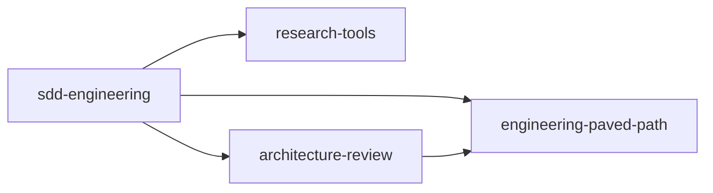
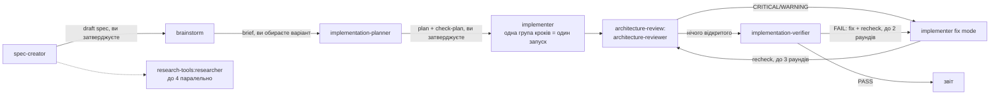

# Специфікація: плагіни Spec Driven Development для `test-ai-marketplace`

| | |
|---|---|
| Статус | Draft v1 — до затвердження; реалізація ще не почата |
| Дата | 2026-10-20 |
| Репо | https://github.com/artemmmon/test-ai-marketplace (гілка `main`) |
| Джерело | https://github.com/artemmmon/dev-digest, `main` @ `e6f0a5d` (`.claude/agents`, `.claude/skills`, `.claude/hooks`, `evals/`) |
| Контекст | GoIT lab: кроки 2–5 («відбираємо components», «dependency graph», «пакуємо sdd-engineering», «реєструємо plugins») |

Нотація: **FR-n** — вимога, **NFR-n** — нефункційна вимога, **R-n** — правило розміщення, **S-n** — spike (перевірка перед реалізацією), **Q-n** — відкрите питання. «MUST / має» — обов'язково, «SHOULD / бажано» — рекомендація.

Ця специфікація описує **що** буде в репозиторії і **як** воно влаштоване. Вона не переносить файли. Реалізація йде окремими PR за §11 після затвердження.

## Зміст

1. [Мета й не-цілі](#1-мета-й-не-цілі)
2. [Стан репо: є зараз і має бути](#2-стан-репо-є-зараз-і-має-бути)
3. [Каталог і граф залежностей](#3-каталог-і-граф-залежностей)
4. [Обмеження платформи Claude Code](#4-обмеження-платформи-claude-code)
5. [Плагін `sdd-engineering`](#5-плагін-sdd-engineering)
6. [Плагіни `research-tools` і `architecture-review`](#6-плагіни-research-tools-і-architecture-review)
7. [Плагін `engineering-paved-path` і правила розміщення skills](#7-плагін-engineering-paved-path-і-правила-розміщення-skills)
8. [Прибирання DevDigest: явні inputs](#8-прибирання-devdigest-явні-inputs)
9. [Версії й релізи](#9-версії-й-релізи)
10. [Документація, evals, перевірки й acceptance](#10-документація-evals-перевірки-й-acceptance)
11. [Фазування](#11-фазування)
12. [Spikes і відкриті питання](#12-spikes-і-відкриті-питання)
13. [Додаток: карта файлів «джерело → ціль»](#13-додаток-карта-файлів-джерело--ціль)

---

## 1. Мета й не-цілі

### 1.1 Мета

Винести з DevDigest набір плагінів, який дає будь-якому репозиторію процес **Spec Driven Development (SDD)**: спека → варіанти реалізації → план → реалізація → верифікація, плюс ретро прогону. Частина плагінів — **reusable dependencies**, які можна ставити окремо; решта складена в `sdd-engineering`, який залежить від них.

Чотири плагіни:

| Плагін | Роль | Що дає |
|---|---|---|
| `engineering-paved-path` | dependency | React, Next.js, Fastify, architecture, testing і security skills |
| `research-tools` | dependency | read-only агент `researcher` |
| `architecture-review` | dependency | узагальнений read-only агент `architecture-reviewer` |
| `sdd-engineering` | головний | 5 агентів SDD, skills `run-plan`, `workflow-retro`, `spec-authoring`, README про те, як усе працює разом, і `CHANGELOG.md` |

### 1.2 Не-цілі

- Перенос будь-чого з DevDigest, що не названо в §5–§7 (зокрема `doc-writer`, `test-writer`, `security-reviewer`, `pr-*` агентів, `pr-self-review`, `dependency-checker`, `devdigest-demo`). Див. Q-3.
- Product specs DevDigest (`specs/*.md`), secrets, cache, DevDigest-specific інструкції (`references/devdigest.md`, `AGENTS.md`, `INSIGHTS.md` DevDigest) — не переносяться (слайд «Не переносимо»).
- Зміни в сайті-каталозі. Сайт уже очікує структуру `plugins/<name>/{plugin.json, README.md, CHANGELOG.md, COMPATIBILITY.md}` і теги `<plugin>--v<semver>` (`docs/specs/site.md` FR-22, FR-26); ця специфікація лише наповнює каталог.
- Реалізація, PR і merge: за запитом користувача.

### 1.3 Принцип відбору

Плагін отримує лише те, що (а) працює без DevDigest і (б) потрібне його ролі. Якщо агент чи skill у джерелі спирається на шлях, команду або конвенцію DevDigest, це не причина лишити їх: вони переносяться **з явним input замість зашитого значення** (§8).

---

## 2. Стан репо: є зараз і має бути

| Елемент | Є зараз | Має бути |
|---|---|---|
| `.claude-plugin/marketplace.json` | `plugins: []` | 4 записи, відсортовані за `name` |
| `plugins/` | лише `.gitkeep` | 4 теки за структурою з §3.2 |
| `scripts/check-marketplace.mjs` | sort / dup / name regex / hidden Unicode / pinning / name+version / frontmatter `name` | + перевірки FR-13 |
| `README.md` (корінь) | «catalogue is empty for now» | таблиця 4 плагінів, порядок встановлення |
| Git tags | немає | `<plugin>--v1.0.0` для кожного плагіна (§9) |
| `docs/specs/` | `site.md` | + цей файл |

Сайт-каталог лишається незмінним; він зчитує `plugins/` і `marketplace.json`.

---

## 3. Каталог і граф залежностей

### 3.1 Граф



- **FR-1.** `sdd-engineering` оголошує три залежності в `plugin.json`, кожну з діапазоном `^1.0.0`:
  ```json
  "dependencies": [
    { "name": "engineering-paved-path", "version": "^1.0.0" },
    { "name": "research-tools",         "version": "^1.0.0" },
    { "name": "architecture-review",    "version": "^1.0.0" }
  ]
  ```
  Бездіапазонний рядок `"name"` не використовується: без діапазону залежність рухається за кожним релізом marketplace ([docs](https://code.claude.com/docs/en/plugin-dependencies)).
- **FR-2.** `architecture-review` залежить від `engineering-paved-path ^1.0.0`. Це **відхилення від слайда кроку 3**, де граф плоский. Причина: узагальнений рев'юер читає rubric зі skills `onion-architecture` і `frontend-architecture`, які лежать у `engineering-paved-path`. Без залежності встановлений окремо `architecture-review` мовчки втратить rubric («якщо skill відсутній, Claude Code його пропускає й пише у debug log»). Див. Q-2.
- **FR-3.** Цикли заборонені. `engineering-paved-path` і `research-tools` не мають залежностей.
- **FR-4.** Залежності встановлюються автоматично, включно з транзитивними. `sdd-engineering` усе одно перелічує `engineering-paved-path` явно: його skills використовують агенти `sdd-engineering` напряму, а не лише через `architecture-review`.

### 3.2 Структура

```
plugins/
  engineering-paved-path/
    .claude-plugin/plugin.json
    skills/{react-best-practices,next-best-practices,fastify-best-practices,
            onion-architecture,frontend-architecture,react-testing-library,security}/…
    README.md  CHANGELOG.md  COMPATIBILITY.md
  research-tools/
    .claude-plugin/plugin.json
    agents/researcher.md
    README.md  CHANGELOG.md  COMPATIBILITY.md
  architecture-review/
    .claude-plugin/plugin.json
    agents/architecture-reviewer.md
    README.md  CHANGELOG.md  COMPATIBILITY.md
  sdd-engineering/
    .claude-plugin/plugin.json
    agents/{spec-creator,brainstorm,implementation-planner,implementer,implementation-verifier}.md
    skills/{run-plan,workflow-retro,spec-authoring}/…
    hooks/hooks.json  scripts/…
    evals/…
    README.md  CHANGELOG.md  COMPATIBILITY.md
```

- **FR-5.** У `.claude-plugin/` лежить лише `plugin.json`. Усе інше (`skills/`, `agents/`, `hooks/`, `README.md`, `CHANGELOG.md`) — у корені плагіна.
- **FR-6.** Кожен плагін самодостатній у своїй теці: жодних symlink, жодних `../`. Плагін копіюється в кеш окремо, зовнішні файли втрачаються.
- **FR-7.** Імена — kebab-case, не починаються з `claude-`, `anthropic-`, `cc-plugin-`. Усі чотири проходять.

---

## 4. Обмеження платформи Claude Code

Це перевірені за документацією факти, що формують дизайн. Те, що документація не підтверджує, винесено в spikes (§12).

| # | Факт | Наслідок у дизайні |
|---|---|---|
| P-1 | Агенти плагіна **ігнорують** frontmatter `hooks`, `mcpServers`, `permissionMode` ([sub-agents](https://code.claude.com/docs/en/sub-agents)) | `spec-creator-guard`, `plans-guard` і `check-*` hooks з DevDigest не можна лишити у frontmatter. Їх переносимо в `hooks/hooks.json` плагіна (FR-18). Spike S-3 |
| P-2 | Агенти плагіна мають scoped-імена `plugin:agent`, напр. `research-tools:researcher` | Усі посилання агентів і skills один на одного в тексті — scoped (FR-17) |
| P-3 | `Agent(type)` у `tools` працює лише для головного треду (`claude --agent`); у subagent-у список типів **ігнорується** | Обмеження «spec-creator може запускати лише researcher» більше не можна виразити в frontmatter; воно лишається тільки в hook (FR-18) і в тексті агента |
| P-4 | `skills:` у frontmatter агента preloads повний текст skills; документація **не** каже, чи працює scoped-ім'я `plugin:skill` і чи видно skills залежностей | Spike S-2; fallback у FR-16 |
| P-5 | Skill з `disable-model-invocation: true` не можна preload-ити в агента | `run-plan` і `workflow-retro` (запускає користувач) — з цим прапорцем; `spec-authoring` — **без** нього (його preload-ить `spec-creator`) |
| P-6 | `${CLAUDE_SKILL_DIR}` → тека `SKILL.md` (для plugin skills — підтека skill, не корінь плагіна); `${CLAUDE_PLUGIN_ROOT}` доступний у skills, agents, hooks; обидва підставляються в тілі Markdown, але **не** в env команд Bash | Скрипти skills шукаються через `${CLAUDE_SKILL_DIR}`, а не `.claude/skills/` (слайд кроку 4). Хуки — через `${CLAUDE_PLUGIN_ROOT}` |
| P-7 | Залежність `{name, version: "^1.0.0"}` резолвиться за git-тегом `<plugin>--v<ver>`; для плагіна з відносним шляхом, якщо тегу немає, береться поточна копія marketplace, а діапазон перевіряється при завантаженні | Теги `--v1.0.0` MUST існувати до того, як хтось поставить плагін із залежністю (§9) |
| P-8 | `userConfig` у `plugin.json` питає значення при вмиканні плагіна; нечутливі значення підставляються як `${user_config.KEY}` у вмісті skills і агентів | Механізм явних inputs (§8.2) |
| P-9 | `claude plugin eval` читає `evals/<case>/{prompt.md, graders/*.md, case.yaml}`; формат `evals.json` зі skill-creator **не** читає; прогін іде в ізольованому workspace без інших плагінів і `CLAUDE.md` | Evals з DevDigest треба конвертувати (§10.3); залежності в ізоляції — spike S-5 |
| P-10 | `claude plugin tag --push` створює `<plugin>--v<version>`, перевіряє `plugin.json` ↔ запис marketplace і чисте дерево | Релізний крок (§9.3) |

---

## 5. Плагін `sdd-engineering`

### 5.1 Склад

**Агенти (5).** Це список із вашого опису; слайд кроку 2 називає чотири («plan-verifier», без brainstorm). Див. Q-1.

| Агент | Джерело в DevDigest | Модель | Що робить | Пише файли |
|---|---|---|---|---|
| `spec-creator` | `agents/spec-creator.md` | opus | Два проходи: звіт discovery (питання, прогалини, edge cases) → після відповідей спека `Status: draft` | лише `<specs_dir>/*.md`, лише `draft` |
| `brainstorm` | `agents/brainstorm.md` | sonnet | 3–5 варіантів реалізації у зваженій матриці з sensitivity-перевіркою, або короткий brief, якщо варіант один; рекомендує один | лише свій brief `<plans_dir>/NN-*.brainstorm.md` |
| `implementation-planner` | `agents/implementation-planner.md` | opus | Review вимог (питання, рекомендації, режим) → Development Plan, у якому кожен крок цитує id спеки (`AC-n`, `EC-n`, `NFR-n`) | лише свій план `<plans_dir>/NN-*.md`, лише `draft` |
| `implementer` | `agents/implementer.md` | sonnet | Виконує одну групу кроків затвердженого плану, лагодить тести, які зламав, запускає checks, звіряє свій diff з планом; режим fix за списком прогалин | код проєкту |
| `implementation-verifier` | `agents/implementation-verifier.md` | sonnet | Останній gate: read-only трасування готового коду до кожної вимоги спеки й кроку плану, вердикт `PASS`/`FAIL`/`INCOMPLETE`; `recheck:` після fix | ні |

**Skills (3).**

| Skill | Хто викликає | Джерело | Призначення |
|---|---|---|---|
| `run-plan` | користувач (`/sdd-engineering:run-plan`) | `skills/sdd` + `skills/feature-flow` | Точка входу. Приймає спеку, план, дизайни і текст вимог у будь-якому поєднанні, визначає стадію й веде її маршрутом §5.3. Див. Q-4 |
| `workflow-retro` | користувач | `skills/workflow-retro` | Міряє завершений прогін за транскриптами на диску (токени, cache read, tool calls, тривалість, паралелізм, вкладені субагенти), пропонує 3–5 конкретних дій і дописує рядок у ledger |
| `spec-authoring` | агенти `spec-creator`, `implementation-planner`, `implementation-verifier` | `skills/spec-authoring` | Шаблон спеки, EARS-критерії, id `US/AC/EC/NFR/OQ`, provenance-теги, lifecycle `draft → approved → implemented`; скрипт `check-spec.mjs` |

- **FR-8.** `run-plan` і `workflow-retro` мають `disable-model-invocation: true` (їх запускає лише користувач, у них є побічні ефекти: запуск агентів, запис ledger). `spec-authoring` — ні (P-5).
- **FR-9.** Усі п'ять агентів і всі skills — англійською, як у джерелі; README і CHANGELOG — англійською для публічного каталогу (Q-6).

### 5.2 Hooks і скрипти

DevDigest тримає захисні й перевірні hooks у frontmatter агентів (P-1 це забороняє для плагіна) і в `.claude/hooks/`.

| Джерело | Призначення | У плагіні |
|---|---|---|
| `hooks/spec-creator-guard.mjs` | `spec-creator` пише лише `specs/*.md` зі `Status: draft`, запускає лише `researcher`, з MCP лише читає Figma | `scripts/spec-creator-guard.mjs`, підключено в `hooks/hooks.json` |
| `hooks/plans-guard.mjs` | `brainstorm` і planner пишуть лише свій файл у `docs/plans/`, лише `draft` | `scripts/plans-guard.mjs` |
| `skills/spec-authoring/assets/check-spec.mjs` | форма спеки; PostToolUse | у skill (`${CLAUDE_SKILL_DIR}/assets/`) + виклик з hook |
| `skills/feature-flow/assets/check-plan.mjs` | план: кожен `AC/EC/NFR` має крок, спека `approved`; `--implemented` для verifier | у `run-plan/assets/` |
| `skills/workflow-retro/assets/{retro.mjs,prices.json}` | вимірювання транскриптів | у skill |

- **FR-10.** Скрипти — самодостатній Node ESM без залежностей, їхні тести (`*.test.mjs`) переносяться поруч.
- **FR-11.** Скрипти знаходять свої файли відносно `${CLAUDE_SKILL_DIR}` / `${CLAUDE_PLUGIN_ROOT}`. Жодного `.claude/skills/` чи `$CLAUDE_PROJECT_DIR/.claude/...` у вмісті плагіна.
- **FR-12.** Шляхи проєкту (теки спек і планів, ledger ретро) скрипти отримують через `CLAUDE_PLUGIN_OPTION_<KEY>` або аргументи, не з констант (§8.2).
- **FR-18.** `hooks/hooks.json` MUST діяти лише для відповідних агентів плагіна, а не для всіх сесій користувача. Для цього кожен guard на початку перевіряє, що викликач — потрібний агент (поле типу агента у вхідному JSON hook-а), і інакше завершується успіхом без дій. Якщо S-3 покаже, що поля немає, fallback: guard працює лише за пам'яттю шляху (`specs_dir`, `plans_dir`) без прив'язки до агента, або guards не постачаються, а ліміти лишаються в `tools` і в тексті агентів.

### 5.3 Маршрут `run-plan`



Правила маршруту, що переносяться без змін по суті (джерело: `agents/README.md`, `feature-flow/SKILL.md`):

- **FR-14.** Два затвердження за користувачем: спека й план стартують `Status: draft`; `approved` ставить головна сесія лише зі слів користувача. `brainstorm` і planner зупиняються на draft-спеці, `implementer` — на draft-плані.
- **FR-15.** План — єдиний handoff до `implementer`: кроки несуть файли, правила з `path:line` і умову «Done when». У prompt агентам — шляхи, не вміст.
- **FR-16.** Fallback preload (P-4): якщо S-2 покаже, що `skills:` не бачить skills залежностей, агенти не мають поля `skills:` для skills з `engineering-paved-path`, а першим кроком у тілі викликають їх через Skill tool за scoped-іменем (`engineering-paved-path:onion-architecture`).
- **FR-17.** Усі посилання між компонентами — scoped: `research-tools:researcher`, `architecture-review:architecture-reviewer`, `engineering-paved-path:react-best-practices`. Власні компоненти — `sdd-engineering:spec-creator` тощо.
- Гілки, що лишаються: фікс-цикл architecture (до 3 раундів, потім зупинка й питання користувачу), verifier (до 2 раундів), amendment затвердженої спеки через `spec-creator` (нове id, рядок `Amended:`, повторне затвердження; id не перенумеровуються).
- Тести за замовчуванням вимкнені (як у джерелі): `implementer` лише лагодить зламані тести. `test-writer` не переноситься (Q-3), тож `--tests` у `run-plan` не постачається у v1.0.0.
- Стадії `security-reviewer`, `doc-writer`, `pr-skill-reviewer`, `pr-self-review` з маршруту джерела **виключені**. `run-plan` завершується звітом після verifier-а й повідомляє, що решта кроків поза плагіном.

### 5.4 `plugin.json`

```json
{
  "name": "sdd-engineering",
  "version": "1.0.0",
  "description": "Spec Driven Development: spec → options → plan → implementation → verification, with a run-plan entry point and a workflow retro",
  "author": { "name": "artemmmon" },
  "license": "<див. Q-7>",
  "keywords": ["sdd", "spec-driven", "planning", "agents"],
  "dependencies": [ /* FR-1 */ ],
  "userConfig": { /* §8.2 */ }
}
```

---

## 6. Плагіни `research-tools` і `architecture-review`

### 6.1 `research-tools` → агент `researcher`

- Джерело: `agents/researcher.md`. Read-only: `tools: Read, Grep, Glob, Bash, WebSearch, WebFetch, AskUserQuestion, Skill`, `disallowedTools: Write, Edit, NotebookEdit`, `model: sonnet`.
- Відповідає на **одне** конкретне питання з репозиторію, зовнішніх джерел або з обох; повертає Repository report і/або External report (Answer · Findings з evidence · Code map / Sources · Conflicts · **Not found**) або Clarification report.
- **FR-19.** Прибрати з тексту DevDigest-приклади (`server/`, `INSIGHTS.md`, `AGENTS.md`). Читати `AGENTS.md` / `CLAUDE.md` / `INSIGHTS.md` лише «якщо існують».
- **FR-20.** Плагін не має залежностей і skills; тека `skills/` відсутня.
- `AskUserQuestion` відфільтровується, коли агент працює як субагент; тому агент має Clarification report як вихід (поведінка джерела, лишається).

### 6.2 `architecture-review` → агент `architecture-reviewer`

- Джерело: `agents/architecture-reviewer.md`. Read-only аудит модуля, пакета чи diff гілки; спершу механічні перевірки, потім судження; повертає один JSON-об'єкт (`checks`, `findings` з `id` і `in_change`, `rechecked`, `rubric_read`, `not_checked`) або clarification JSON; `recheck:` після fix.
- `skills: onion-architecture, frontend-architecture` — з `engineering-paved-path` (FR-2, FR-16).
- **FR-21 (узагальнення).** Три зашиті команди DevDigest (`pnpm arch`, `pnpm lint`, `./scripts/shared-contracts.sh check`) замінюються input-ом `checks` — списком команд, які агент може виконати (за замовчуванням порожній; тоді `checks: []` і `not_checked` називає причину). Агент, як і раніше, не запускає `--fix` / `sync`.
- **FR-22.** Тека `client/` / `server/` більше не зашита: `mode: module` приймає `target`, а правила для сервера й клієнта обираються за змістом `target` (бекенд → `onion-architecture`, фронтенд → `frontend-architecture`).
- **FR-23.** Схема вихідного JSON не змінюється (її читає `run-plan`).
- `architecture-reviewer-lite` (експеримент у джерелі) **не переноситься**.

---

## 7. Плагін `engineering-paved-path` і правила розміщення skills

### 7.1 Правила розміщення

- **R-1.** Skill живе в тому плагіні, чиї агенти чи маршрут його використовують **і** де він не потрібен іншим. Workflow-skills (`run-plan`, `workflow-retro`, `spec-authoring`) — у `sdd-engineering`.
- **R-2.** Skill знань про стек, архітектуру, тести й безпеку, який потрібен агентам кількох плагінів або самій людині без SDD, — у `engineering-paved-path`.
- **R-3.** Один skill живе рівно в одному плагіні. Дублі між плагінами заборонені; решта користується через залежність.
- **R-4.** Залежності йдуть лише в бік «споживач → постачальник» (граф §3.1). Постачальник не знає про споживача.
- **R-5.** Skill, у якого є `references/devdigest.md` (мапінг правил на DevDigest) чи скрипт із зашитими шляхами DevDigest, переноситься без цього файла; його вміст або узагальнюється в `references/`, або відкидається (§8).

### 7.2 Розподіл skills із DevDigest

| Skill (DevDigest) | Рішення | Куди | Примітка |
|---|---|---|---|
| `react-best-practices` | **включити** | `engineering-paved-path` | походження не в `skills-lock.json` — встановити автора й ліцензію (NFR-2) |
| `next-best-practices` | **включити** | `engineering-paved-path` | vendored з `vercel-labs/next-skills` |
| `fastify-best-practices` | **включити** | `engineering-paved-path` | vendored з `mcollina/skills` |
| `onion-architecture` | **включити, узагальнити** | `engineering-paved-path` | прибрати `references/devdigest.md`; `assets/dependency-cruiser.cjs` лишити як приклад конфігу з параметризованими шарами |
| `frontend-architecture` | **включити, узагальнити** | `engineering-paved-path` | прибрати `references/devdigest.md` |
| `react-testing-library` | **включити** | `engineering-paved-path` | категорія «testing» зі слайда; походження — перевірити (NFR-2) |
| `security` | **включити, переписати** | `engineering-paved-path` | у джерелі це trust boundaries DevDigest (SSRF guard, clone paths, prompt fencing); у v1.0.0 — стек-незалежні правила (вхід, вихідний HTTP, SQL, процеси, секрети/логи, CI) і шкала оцінки findings |
| `spec-authoring` | включити | `sdd-engineering` | R-1 |
| `feature-flow` + `sdd` | об'єднати в `run-plan` | `sdd-engineering` | Q-4 |
| `workflow-retro` | включити | `sdd-engineering` | |
| `engineering-insights` | **відкрите** | Q-5 | використовують planner, implementer; прив'язаний до `INSIGHTS.md` DevDigest |
| `zod`, `typescript-expert`, `drizzle-orm-patterns`, `postgresql-table-design` | не в v1.0.0 | — | слайд не називає; усі vendored — потрібна ліцензія. Кандидати на 1.1.0 (Q-3) |
| `mermaid-diagram`, `dependency-checker`, `pr-self-review`, `devdigest-demo` | не переносити | — | `devdigest-demo` — DevDigest-specific; інші не в списку |

- **FR-24.** Каталог `engineering-paved-path` — лише skills, без агентів, hooks і MCP. Скрипти допустимі лише як приклади, які skill просить запустити явно (наприклад, конфіг dependency-cruiser).
- **FR-25.** Vendored skills зберігають upstream-структуру, `LICENSE` і посилання на джерело в `README.md` плагіна та в `references`/шапці skill (у джерелі це `skills-lock.json`, у плагіні — секція «Sources» у README).
- **FR-26.** Звідки викликати: з агентів — за scoped-іменем (FR-17); користувач бачить їх як `/engineering-paved-path:<skill>`.
- **FR-27.** У кожного skill `description` — з тригерами; `name` у frontmatter = ім'я теки (перевіряє `check-marketplace.mjs`).

---

## 8. Прибирання DevDigest: явні inputs

### 8.1 Правила

- **FR-28.** У вмісті плагінів (агенти, skills, скрипти, README) заборонені: слово `DevDigest` (крім згадки «extracted from DevDigest» у кореневому README і секції Sources), шляхи `server/`, `client/`, `reviewer-core/`, `.claude/skills/`, `.claude/hooks/`, `$CLAUDE_PROJECT_DIR/.claude/`, команди `pnpm …`, `./scripts/check-changed.sh`, `./scripts/shared-contracts.sh`, посилання на `routing.json`, `AGENTS.md` DevDigest, `INSIGHTS.md` як обов'язковий файл.
- **FR-29.** Що не переноситься: product specs, секрети, cache-файли, DevDigest-specific інструкції (слайд кроку 2).

### 8.2 Inputs через `userConfig` і аргументи

Замість зашитих значень `sdd-engineering` оголошує `userConfig` (нечутливі значення; підставляються як `${user_config.KEY}` у вмісті агентів і skills і як `CLAUDE_PLUGIN_OPTION_<KEY>` у hooks):

| Ключ | Тип | Default | Замінює в DevDigest |
|---|---|---|---|
| `specs_dir` | directory | `specs` | `specs/`, `<package>/specs/` |
| `plans_dir` | directory | `docs/plans` | `docs/plans/` |
| `retro_ledger` | file | `docs/retros/ledger.md` | `docs/retros/ledger.md` |
| `check_commands` | string, `multiple: true` | порожній | `./scripts/check-changed.sh`, `pnpm typecheck/test/lint` |
| `architecture_checks` | string, `multiple: true` | порожній | `pnpm arch`, `pnpm lint`, `shared-contracts.sh check` |

- **FR-30.** Порожні `check_commands` означають: `implementer` бере команди з секції **Verification** затвердженого плану, а `implementation-verifier` — з тієї ж секції; без них обидва явно пишуть у звіті «checks not run: no commands configured».
- **FR-31.** `routing.json` (мапа «шлях → skills → checks» із `pr-self-review`) **не переноситься**. Planner підбирає skills за їхніми `description` серед доступних і за `CLAUDE.md` / `AGENTS.md` проєкту (якщо існують) і записує вибір у кроки плану (`Practices`, `load:`). Це змінює джерело: там мапа детермінована. Див. Q-8.
- **FR-32.** Інструкція «читати `INSIGHTS.md` модуля» стає умовною (Q-5).
- **FR-33.** Агенти приймають inputs і в prompt (`specs_dir:`, `plans_dir:`, `checks:`), prompt перекриває `userConfig`.

---

## 9. Версії й релізи

- **FR-34.** SemVer. Усі чотири плагіни стартують з `1.0.0`. `version` задається в `plugin.json`; запис у `marketplace.json` його не дублює (правило кореневого README: «version in `plugin.json` only»). Це відхилення від слайда кроку 5, де `version` названо поряд з `name`, `owner`, `source`; див. Q-9.
- **FR-35.** Кожен плагін має `CHANGELOG.md` у форматі Keep a Changelog. Заголовок релізу — `## [1.0.0] - 2026-10-20` (його розпізнає `scripts/build-index.mjs` сайту, FR-26 у `site.md`); `## [Unreleased]` — зверху. Найновіша версія в changelog = `version` у `plugin.json`.
- **FR-36.** Кожен плагін має `COMPATIBILITY.md`: мінімальна версія Claude Code (залежність від `userConfig`, `dependencies` з діапазонами, `claude plugin tag` — визначити з документації і ввести числом), перелік залежностей і діапазони. Сайт відображає його у «Details».
- **FR-37.** Bump `version` обов'язковий при будь-якій зміні вмісту плагіна (інакше користувачі не отримають файли). Зміна, що ламає scoped-імена, `userConfig`-ключі, вихідний JSON агентів або формат спеки / плану, — MAJOR.
- **FR-38.** Правило діапазонів: `sdd-engineering` оголошує `^1.0.0`. MINOR/PATCH залежностей підхоплюються; MAJOR залежності вимагає нового релізу `sdd-engineering` з розширеним діапазоном після прогону evals.

### 9.3 Порядок релізу

1. Релізити залежності першими: `engineering-paved-path`, `research-tools`; потім `architecture-review` (залежить від першого); останнім — `sdd-engineering`.
2. Для кожного: `claude plugin validate` → `node scripts/check-marketplace.mjs` → коміт з bump і записом у CHANGELOG → тег `claude plugin tag plugins/<name> --push` (`<plugin>--v1.0.0`).
3. Теги MUST бути запушені **до** того, як `marketplace.json` з записами потрапить у `main` (P-7), інакше залежність пройде резолв лише «за поточною копією» і діапазон не перевірено за тегом.
4. Реліз `sdd-engineering` без оновлення tag залежностей, що змінилися, заборонено.

---

## 10. Документація, evals, перевірки й acceptance

### 10.1 README `sdd-engineering` (обов'язково, «як усе працює разом»)

Секції:

1. Що це і для кого; діаграма залежностей (§3.1).
2. Установлення: `claude plugin marketplace add artemmmon/test-ai-marketplace`, `claude plugin install sdd-engineering@test-ai-marketplace` (залежності ставляться самі); як оновлювати (ручне оновлення з кореневого README).
3. Склад: таблиця агентів (роль · модель · що пише · що не може) і skills.
4. Маршрут: діаграма §5.3 і пояснення двох затверджень, bounded fix-циклів та «спека каже що, план каже як».
5. Швидкий старт: приклад прогону `run-plan` від тексту вимог і від готової спеки; як викликати окремого агента за іменем (`--only spec`, `--only plan`, якщо Q-4 залишить прапорці).
6. Inputs: таблиця `userConfig` (§8.2) і де їх змінити.
7. Хто від кого залежить і чому (`engineering-paved-path`, `research-tools`, `architecture-review`) — з посиланням на їхні README.
8. Що навмисно не входить (§1.2) і як це підключити окремо.
9. Вартість: коротко про принцип «шляхи, не вміст», один запуск implementer на групу, відсутність тестового етапу — з джерела `agents/README.md` «Keeping token cost down».
10. Ретро: що міряє `workflow-retro`, куди пише ledger.
11. Безпека: що виконує плагін (hooks, скрипти) — перелік файлів, які варто прочитати перед установленням.
12. Посилання на `CHANGELOG.md` і `COMPATIBILITY.md`.

README інших трьох плагінів — коротші: призначення, склад, input-контракт агента, залежності, версія.

### 10.2 Кореневий README

Таблиця плагінів (назва · роль · залежності · версія), «починайте з `sdd-engineering`» і посилання на `docs/specs/sdd-plugins.md`.

### 10.3 Evals

- **FR-39.** Слайд кроку 4 вимагає переносити evals. Формат DevDigest (`evals.json`: `id, skills, query, files, expected_behavior`) не читається `claude plugin eval` (P-9). Кожен кейс конвертується в `evals/<case>/prompt.md` + `graders/*.md` (`type: llm` з PASS/FAIL-критеріями з `expected_behavior`; `type: tool_used` для перевірки, що skill спрацював).
- **FR-40.** Джерела кейсів: `skills/{workflow-retro,spec-authoring,feature-flow,sdd,security,onion-architecture}/evals/evals.json`, `evals/agents/architecture-reviewer`. Кейси, що посилаються на DevDigest-файли (`files: [".claude/skills/…/devdigest.md"]`), переписуються на fixtures у `evals/<case>/resources/` або відкидаються.
- **FR-41.** Evals розміщуються в тому плагіні, чию поведінку перевіряють. Кейси `sdd-engineering` залежать від чужих агентів — S-5.

### 10.4 Перевірки

- **FR-13.** `scripts/check-marketplace.mjs` розширюється (зі збереженням самодостатності, без залежностей):
  - усі `dependencies[].name` існують у `plugins[]` цього marketplace;
  - діапазон кожної залежності задовольняє `version` з її `plugin.json`;
  - немає циклів у графі залежностей;
  - тег `<plugin>--v<version>` існує для кожного плагіна з `dependencies` на нього (попередження до першого релізу, помилка після);
  - у `agents/*.md` немає frontmatter `hooks`, `mcpServers`, `permissionMode` (вони ігноруються, P-1);
  - у вмісті плагінів немає заборонених рядків FR-28;
  - у кожного плагіна є `README.md`, `CHANGELOG.md`, `COMPATIBILITY.md`; найновіша версія changelog = `version`;
  - немає symlink і шляхів з `..` (FR-6).

### 10.5 Acceptance

| # | Перевірка | Очікуваний результат |
|---|---|---|
| AC-1 | `claude plugin validate .` | passed (без `--strict` warnings) |
| AC-2 | `node scripts/check-marketplace.mjs` | exit 0 |
| AC-3 | `claude --plugin-dir plugins/engineering-paved-path --plugin-dir plugins/research-tools --plugin-dir plugins/architecture-review --plugin-dir plugins/sdd-engineering` | усі компоненти завантажені, у `/plugin` немає Errors |
| AC-4 | локальна установка з marketplace (`claude plugin marketplace add ./`) `sdd-engineering` у чистому профілі | три залежності встановлені; `claude plugin list` показує їхні версії |
| AC-5 | `run-plan` на тестовому проєкті без DevDigest, від текстових вимог | spec-creator повертає discovery report; після відповідей з'являється `<specs_dir>/NN-*.md` зі `Status: draft`; жодного звернення до шляху DevDigest |
| AC-6 | guard-перевірки | `spec-creator` не може записати спеку зі `Status: approved` і не може запустити агента, крім `researcher`; planner не може записати поза `plans_dir` (за умови S-3) |
| AC-7 | `claude plugin eval` для кожного плагіна | проходить поріг, зафіксований у README (початковий — прохід усіх кейсів) |
| AC-8 | `grep -ri devdigest plugins/` | лише допустимі входження (FR-28) |
| AC-9 | сайт: `node scripts/build-index.mjs` | `index.json` містить 4 плагіни, компоненти за типами, залежності зі статусом `satisfied`, релізи з changelog |

- **NFR-1.** Плагіни не містять секретів і абсолютних шляхів до машини автора.
- **NFR-2.** Кожен vendored або стороннього походження skill має ліцензію, що дозволяє публічний redistribution; без підтвердженої ліцензії skill не потрапляє у `engineering-paved-path` v1.0.0.
- **NFR-3.** Розмір кожного `SKILL.md` — як у джерелі (близько 100–150 рядків для власних); довгі теми — в `references/`.

---

## 11. Фазування

Кожна фаза — окрема гілка й PR в `main`, за `CLAUDE.md` проєкту. Merge — лише на прохання користувача.

| Фаза | Зміст | Залежить від |
|---|---|---|
| P0 | Spikes S-1…S-5 (§12.1), результат — оновлення цієї специфікації | — |
| P1 | `engineering-paved-path` (після NFR-2) + `check-marketplace.mjs` (FR-13) | P0 |
| P2 | `research-tools` | P0 |
| P3 | `architecture-review` | P1 |
| P4 | `sdd-engineering`: агенти, skills, hooks/scripts, `userConfig`, evals, README | P1–P3 |
| P5 | записи в `marketplace.json`, теги `--v1.0.0`, кореневий README, перевірка AC-1…AC-9 | P1–P4 |

P2 і P3 незалежні й можуть іти паралельно (кожна в своєму worktree); P1 стартує першою, бо від неї залежать P3 і P4.

---

## 12. Spikes і відкриті питання

### 12.1 Spikes (перевірити до реалізації)

| # | Що перевірити | Метод | Впливає на |
|---|---|---|---|
| S-1 | Мінімальна версія Claude Code для `userConfig`, `dependencies` з діапазонами, `claude plugin tag`, `claude plugin eval` | `claude plugin validate`, документація, локальна 2.1.304 | FR-36 |
| S-2 | Чи працює `skills:` у frontmatter агента плагіна зі scoped-іменем `engineering-paved-path:onion-architecture` і чи видно skills залежності | міні-плагін з двох частин, запуск агента з `--plugin-dir` | FR-16, FR-2 |
| S-3 | Чи містить вхід PreToolUse-hook плагіна ідентифікатор агента (тип) і чи можна надійно обмежити guard одним агентом | міні-hook, що пише вхідний JSON у файл | FR-18, AC-6 |
| S-4 | Чи працюють `${CLAUDE_SKILL_DIR}` і `${user_config.KEY}` у тілі агента та skill, чи доходить `CLAUDE_PLUGIN_OPTION_*` до hook-скриптів | міні-плагін | FR-11, FR-12, §8.2 |
| S-5 | Чи завантажує `claude plugin eval` залежності плагіна в ізольованому workspace | eval-кейс для `sdd-engineering` | FR-41 |

### 12.2 Відкриті питання

Для кожного вказано дефолт, на якому написана специфікація.

- **Q-1. Склад агентів.** Ви назвали п'ять агентів (spec-creator, brainstorm, implementation-planner, implementer, implementation-verifier); слайд кроку 2 — чотири (spec-creator, implementation-planner, implementer, **plan-verifier**), без brainstorm. *Дефолт: п'ять, ім'я verifier-а `implementation-verifier` (як у DevDigest і у вашому тексті).* Якщо потрібен `plan-verifier` — це перейменування; якщо без brainstorm — маршрут §5.3 втрачає крок вибору варіанта.
- **Q-2. Залежність `architecture-review → engineering-paved-path`.** Слайд цього не показує. *Дефолт: додано (FR-2).* Альтернатива — зробити рев'юера рубричним без skills (input `rubric:` зі шляхом) і лишити граф плоским.
- **Q-3. Що з `doc-writer`, `test-writer`, `security-reviewer`, `pr-*` і додатковими skills (`zod`, `typescript-expert`, drizzle, postgres, `mermaid-diagram`).** Не названі, тому не входять у 1.0.0.
- **Q-4. Що саме таке `run-plan`.** У DevDigest окремого `run-plan` немає: ближчі `/sdd` (повний маршрут від довільного входу) і `feature-flow`. Слайд описує `run-plan` як виконання **затвердженого плану**. *Дефолт: `run-plan` = `sdd` + `feature-flow` разом; приймає будь-яку стадію (`--from`, `--until`, `--only`); виконання затвердженого плану — один з режимів.* Альтернатива: `run-plan` лише від затвердженого плану, а перші дві стадії користувач запускає агентами за іменем.
- **Q-5. `engineering-insights` / `INSIGHTS.md`.** Це конвенція DevDigest, на яку спираються planner і implementer. *Дефолт: у v1.0.0 не переноситься; агенти читають `INSIGHTS.md` лише якщо він існує (FR-32).*
- **Q-6. Мова документів.** Агенти й skills — англійською (як у джерелі, потрібне для публічного каталогу). Ця специфікація — українською, як `site.md`. *Дефолт: README і CHANGELOG плагінів англійською.*
- **Q-7. Ліцензія** плагінів і переносу vendored skills (NFR-2).
- **Q-8. `routing.json`.** Без нього відбір skills планувальником недетермінований (FR-31). *Дефолт: не переноситься.* Альтернатива: необов'язковий input `routing_file`.
- **Q-9. `version` у записі marketplace.** Слайд показує `name, version, owner, source`; кореневий README і `claude plugin tag` припускають одне джерело правди. *Дефолт: лише `plugin.json`; `owner` лишається на рівні marketplace, у `plugin.json` — `author`.*

---

## 13. Додаток: карта файлів «джерело → ціль»

Шляхи джерела — відносно `dev-digest/.claude/`. «—» означає «не переноситься».

| Джерело | Ціль | Зміни |
|---|---|---|
| `agents/spec-creator.md` | `sdd-engineering/agents/spec-creator.md` | прибрати `hooks:` (P-1); `skills: spec-authoring` + security за FR-16; шляхи → `${user_config.specs_dir}`; Figma: у `tools` обидва відомі префікси MCP-сервера (`mcp__plugin_figma_figma`, `mcp__plugin_design_figma`), бо ім'я залежить від установки |
| `agents/brainstorm.md` | `sdd-engineering/agents/brainstorm.md` | прибрати `hooks:`; `docs/plans` → `plans_dir`; skills архітектури — з paved-path |
| `agents/implementation-planner.md` | `sdd-engineering/agents/implementation-planner.md` | прибрати `hooks:`; прибрати `routing.json` (FR-31); `pnpm`, `scripts/*.sh` → Verification і `check_commands` |
| `agents/implementer.md` | `sdd-engineering/agents/implementer.md` | прибрати `server/`, `client/`, `reviewer-core`, `pnpm …`; checks з плану / `check_commands` |
| `agents/implementation-verifier.md` | `sdd-engineering/agents/implementation-verifier.md` | `check-plan.mjs --implemented` з `run-plan/assets`; checks з плану |
| `agents/researcher.md` | `research-tools/agents/researcher.md` | FR-19 |
| `agents/architecture-reviewer.md` | `architecture-review/agents/architecture-reviewer.md` | FR-21…FR-23 |
| `agents/{architecture-reviewer-lite,doc-writer,test-writer,security-reviewer,pr-skill-reviewer,pr-finding-verifier}.md`, `agents/README.md` | — | агентський README переписується в README плагіна |
| `hooks/{spec-creator-guard,plans-guard}.mjs` (+ тести) | `sdd-engineering/scripts/` | переписати на `userConfig`-шляхи й перевірку агента (FR-18) |
| `skills/spec-authoring/**` | `sdd-engineering/skills/spec-authoring/**` | без `references/devdigest.md`; `check-spec.mjs` + тести + `spec-template.md`, `ears.md`, `design-gaps.md`, `example-spec.md` |
| `skills/sdd/**`, `skills/feature-flow/**` | `sdd-engineering/skills/run-plan/**` | Q-4; `check-plan.mjs` + тести → `assets/`; `handoffs.md` → `references/`; без `devdigest.md` |
| `skills/workflow-retro/**` | `sdd-engineering/skills/workflow-retro/**` | `retro.mjs`, `prices.json`, тести, `reading.md`; ledger → `retro_ledger`; без `devdigest.md` |
| `skills/{react-best-practices,next-best-practices,fastify-best-practices,react-testing-library}/**` | `engineering-paved-path/skills/…` | upstream-структура, LICENSE, Sources |
| `skills/{onion-architecture,frontend-architecture}/**` | `engineering-paved-path/skills/…` | без `devdigest.md`; узагальнити приклади |
| `skills/security/**` | `engineering-paved-path/skills/security/` | переписати (§7.2) |
| `skills/*/evals/evals.json`, `evals/agents/architecture-reviewer/**` | `<plugin>/evals/<case>/` | конвертація (FR-39, FR-40) |
| `settings.json` (hook `pr-self-review`) | — | DevDigest-specific |
| `skills/{engineering-insights,mermaid-diagram,dependency-checker,pr-self-review,devdigest-demo,zod,typescript-expert,drizzle-orm-patterns,postgresql-table-design}/**` | — | Q-3, Q-5 |
