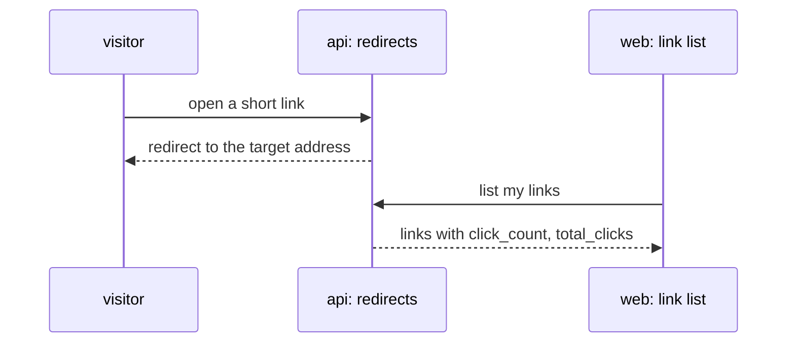

# Spec: Link Click Counter
Spec ID: SPEC-00
Status: draft
Supersedes: none
Packages: api, web
Sources: user brief (a worked example of the template; SPEC-00 is not a live spec)

## Problem and user
An owner of short links in a URL shortener cannot see whether anyone uses them. Every visit is
redirected, but nothing is recorded, so the owner has to ask an outside analytics tool, long after
the visits, which link was worth sharing.

## Goals / Non-goals
**Goals**
- The owner sees how many times each short link was opened, next to the link, without leaving the
  link list.
- The total shown for the owner describes the same links as the list below it.

**Non-goals**
- Clicks made before this feature shipped — they were never recorded, so there is nothing to show.
- Counting each visitor once — it needs a way to tell visitors apart (OQ-1).
- Filtering out crawlers and bots — the shortener has no rule yet for what a bot is.

## User stories
- US-1: As a link owner, I want to see how many times each short link was opened, so that I can
  tell which links are used.
- US-2: As a link owner, I want to see the total number of opens across all my links, so that I
  can judge the reach of a campaign.

## Workflow and module interactions

Contract fields that cross the api → web boundary:
- link summary `click_count: number` — `0` means "no recorded click";
- link list `total_clicks: number` — the sum of `click_count` over the owner's links.

## Acceptance criteria (EARS)
- AC-1 (US-1): WHEN a visitor is redirected through a short link, the api shall add 1 to that
  link's click count.
- AC-2 (US-1): WHILE a link has at least one recorded click, the link list shall show the count
  next to the short address, in the form `1,204 clicks`.
- AC-3 (US-1): IF a link has no recorded click, THEN the link list shall show `No clicks yet` in
  place of the count.
- AC-4 (US-2): The link list shall show, above the links, the sum of the click counts of all the
  owner's links.
- AC-5 (US-2): IF the owner has no links, THEN the link list shall show the total as `0`.
- AC-6 (US-1, US-2): WHILE a count is below 10,000, the link list shall show it as a whole number
  with thousands separators.
- AC-7 (US-1, US-2): WHILE a count is at least 10,000 but below 1,000,000, the link list shall
  show it in thousands with 1 decimal, as `12.3k`.
- AC-8 (US-1, US-2): WHILE a count is 1,000,000 or more, the link list shall show it in millions
  with 1 decimal, as `1.2M`.
- AC-9 (US-1): IF a visitor opens a short code that does not exist, THEN the api shall leave every
  click count unchanged.

## Edge cases
- EC-1: a link created before this feature shipped → `No clicks yet`, never a blank or negative
  count (AC-3)
- EC-2: two visitors open the same link at the same moment → both opens are counted (AC-1)
- EC-3: the owner deletes a link → its clicks leave the total (AC-4)
- EC-4: a count of exactly 10,000 → the higher band's format applies (AC-7)
- EC-5: a request for a code that was deleted → nothing is counted (AC-9)

## Non-functional requirements
- NFR-1: Recording a click adds at most 20 ms to a redirect at the 95th percentile.
- NFR-2: A screen reader announces a count as text, in the same form it is shown (`1,204 clicks`).

## Inputs and provenance
| Input | Provenance | Notes |
|---|---|---|
| A visit to a short link | [reused: redirect handler] | It already runs on every visit; it did not record anything |
| Owner of a link | [reused: link ownership records] | Needed to sum per owner |
| Links of one owner | [deterministic: links] | Counts are read from stored data, no model |

## Untrusted inputs
| Input | Who controls it | Where it goes | Required handling |
|---|---|---|---|
| Short code in the visited address | Any visitor | Looked up among the stored codes | Matched exactly as data; a code that matches nothing changes nothing |

## Open questions
- OQ-1: Should repeated opens by the same visitor count once? — default if unanswered: no; every
  redirect counts.
